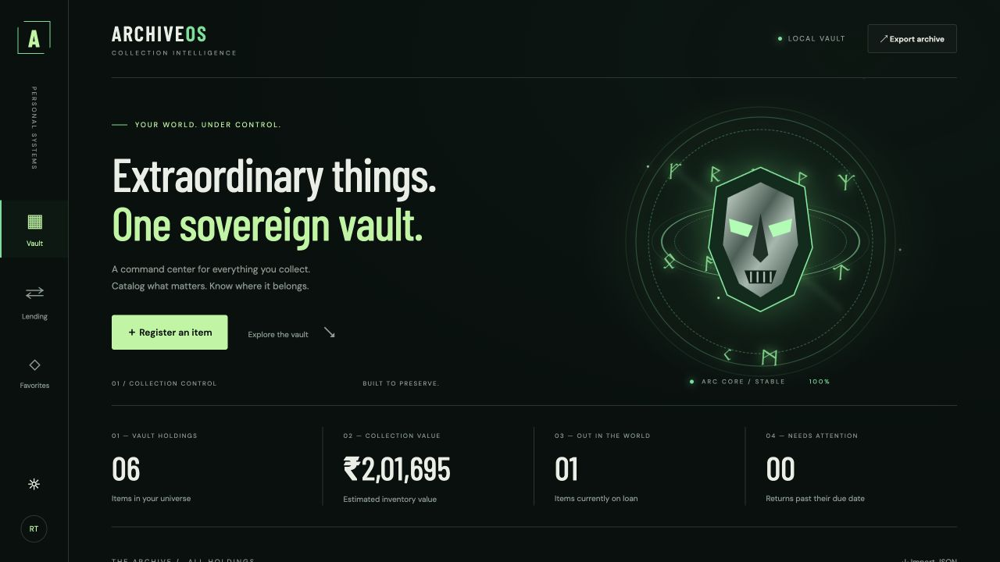

<div align="center">

# ARCHIVEOS
### Your world. Under control.

A personal collection and lending command center with an emerald reactor aesthetic, persistent file storage, and a responsive interface.

<p>
 &nbsp;
 &nbsp;
 &nbsp;
 &nbsp;
 &nbsp;

 &nbsp;
 &nbsp;

</p>

</div>

**[Open live app](https://archive-os-rachit.onrender.com)** · **[Source code](https://github.com/rachit1807/archive-os)**



## Overview

ArchiveOS gives books, technology, collectibles, and games a permanent home. Register possessions, organize the details, record loans, and keep track of what should come back. The interface combines gunmetal surfaces, emerald illumination, a geometric mask, animated rune orbits, and restrained typography.

## Object workflow

1. **Catalog an object:** record its identity, category, value, and starting condition.
2. **Assign its physical home:** record the room, cabinet, or shelf where it belongs.
3. **Lend it:** capture the borrower and expected return date at handover.
4. **Receive and inspect:** confirm the condition and storage location before completing the return.
5. **Follow its history:** open the Object Passport to see cataloging, locations, loans, returns, inspection notes, and dates.

The **Attention** queue collects overdue objects, objects without a home, and objects needing care. Objects on loan cannot be relocated or inspected until received. Objects needing care cannot be lent until a new inspection resolves their condition. Catalog corrections cannot bypass these circulation rules.

## Features

- **Collection management:** create, edit, delete, and favorite items; record category, condition, location, value, description, and tags.
- **Lending:** borrower and return-date records, overdue indicators, guided return inspections, and a permanent object timeline.
- **Discovery:** live search, category filters, and sorting by name, value, or date.
- **Overview:** inventory count, total estimated value, active loans, and overdue returns.
- **Portability:** JSON export and validated import; imported records receive fresh identifiers.
- **Durability:** server-side JSON text storage, serialized mutations, atomic replacement, and a previous-version backup.
- **Appearance:** persistent light/dark preference, responsive navigation and cards, keyboard focus states, and reduced-motion support.
- **Developer workflow:** a small dependency footprint, native Node.js tests, Docker support, and CI.
- **Private cloud accounts:** registration, sign-in, sign-out, hashed passwords, HttpOnly session cookies, and account-isolated collections.

## Run locally

Requires **Node.js 22 or newer**.

```sh
npm ci
npm start
```

Open **http://localhost:3000**. Run `npm ci` once before starting. No frontend build step is required.

```sh
npm run dev   # Restart the server when server files change
npm test      # Storage durability and recovery safeguards
```

Start with an empty vault or choose **Load sample collection**. Sample data is fictional and is stored in the same vault as regular items.

The cloud integration test runs only when `ARCHIVE_TEST_DATABASE_URL` points to a dedicated test-capable database; it creates and removes synthetic test accounts. It covers private vault isolation, authentication, session revocation, and persistent records.

## Configuration

| Variable | Default | Purpose |
| --- | --- | --- |
| `PORT` | `3000` | HTTP listening port |
| `DATA_DIR` | `./data` | Directory for persistent archive files |
| `DATABASE_URL` | unset | Dedicated PostgreSQL connection; enables private cloud accounts |
| `ARCHIVE_PASSWORD` | unset | Optional HTTP Basic protection for API routes; username is `archive` |

Use a dedicated `DATABASE_URL` and HTTPS for hosted use. Local file mode is unauthenticated unless protected with `ARCHIVE_PASSWORD`; keep it on a trusted computer. Local file mode is a single-owner workspace. When `DATABASE_URL` is configured, the hosted app requires registration/sign-in and isolates each account’s records.

## Architecture

```text
Browser interface
      │ same-origin JSON requests
      ▼
Node.js HTTP server → input validation
      │ serialized mutations
      ▼
archive.json.tmp → atomic rename → archive.json
                                      │
                               archive.json.bak
```

| Path | Responsibility |
| --- | --- |
| `public/` | Interface, original vector artwork, theme, and interactions |
| `server.js` | HTTP routes, validation, optional authentication, static assets |
| `lifecycle.js` | Validated custody, location, and condition transitions |
| `auth.js` | Scrypt password hashing, expiring opaque sessions, account access |
| `postgres.js` | Dedicated cloud storage and transactional per-account mutations |
| `storage.js` | File reads, write queue, backups, atomic persistence |
| `test/` | Automated storage tests |
| `.github/workflows/ci.yml` | Continuous verification |
| `Dockerfile` | Unprivileged container runtime |

## API

| Method | Route | Action |
| --- | --- | --- |
| POST | `/api/auth/register` | Create a cloud account |
| POST | `/api/auth/login` | Sign in |
| GET | `/api/auth/me` | Read session state |
| POST | `/api/auth/logout` | Revoke current session |
| GET | `/api/health` | Service health |
| GET | `/api/items` | Read the archive |
| POST | `/api/items` | Create an item |
| PUT | `/api/items/:id` | Correct catalog metadata |
| POST | `/api/items/:id/actions` | Locate, lend, receive, or inspect an object |
| DELETE | `/api/items/:id` | Delete an item |
| POST | `/api/import` | Append a validated version-1 export |

Item fields include `name`, `category`, `condition`, `value`, `location`, `description`, `tags`, `borrower`, `due`, and `favorite`. Dates use `YYYY-MM-DD`; values are displayed in INR. The server assigns IDs and timestamps. Import accepts up to 5,000 items and a 1 MB request body.

## Persistence and recovery

The first read creates the storage directory. An absent archive starts empty. Invalid JSON is reported as an error and is never silently replaced. A successful mutation saves the prior archive to `archive.json.bak`, writes a temporary file, and renames it into place.

To recover, stop the server, preserve the damaged file separately, validate the backup as JSON with a `version: 1` and an `items` array, then copy the backup to `archive.json` and restart. Export regularly for off-device backups.

The write queue protects one server process. Run **one instance** against the data directory. Multiple processes, distributed deployments, and network filesystems require a different locking/storage design.

## Deployment

The hosted configuration uses a free Render Node.js service and a separate Neon PostgreSQL project in Singapore. Its production branch has **no scheduled expiry**. Free-plan quotas apply, and Render may sleep after inactivity. Existing project databases are not used or changed.

Set `DATABASE_URL` with TLS enabled and `NODE_ENV=production`. The app initializes its own tables. Cloud mutations use PostgreSQL transactions and row locks; sessions are stored durably and expire after seven days. Local file data is not automatically uploaded: export it, sign in to the cloud app, and import the JSON.

For file-based hosting instead, mount a persistent disk and set `DATA_DIR` to that mount. Ephemeral filesystems lose local records on redeploy; static hosting and GitHub Pages cannot run the backend.

```sh
docker build -t archive-os .
docker run --rm -p 3000:3000 -v archive-data:/app/data -e ARCHIVE_PASSWORD archive-os
```

The Docker command forwards `ARCHIVE_PASSWORD` from your shell environment. Set it before starting the container. Configure an HTTPS reverse proxy or a managed host with automatic HTTPS.

## Accessibility and motion

Semantic controls, labeled forms, visible focus indicators, native modal dialogs, and live status messages support keyboard use. Decorative effects are hidden from assistive technology. Animations stop when the operating system requests reduced motion.

## Account limitations

Passwords require 10–128 characters. Password reset and email verification are not implemented. Use a password manager and export important collections independently. The built-in authentication attempt limiter is per server process; larger deployments should add a shared limiter and account recovery.

## Design notes

This is an independent fan-inspired portfolio project. Doctor Doom and related characters belong to their respective rights holders. The interface uses original SVG geometry and CSS effects; no official movie artwork is included. Google Fonts and README technology icons require an internet connection; local font fallbacks remain available.

## Author

**Rachit Tripathi**
